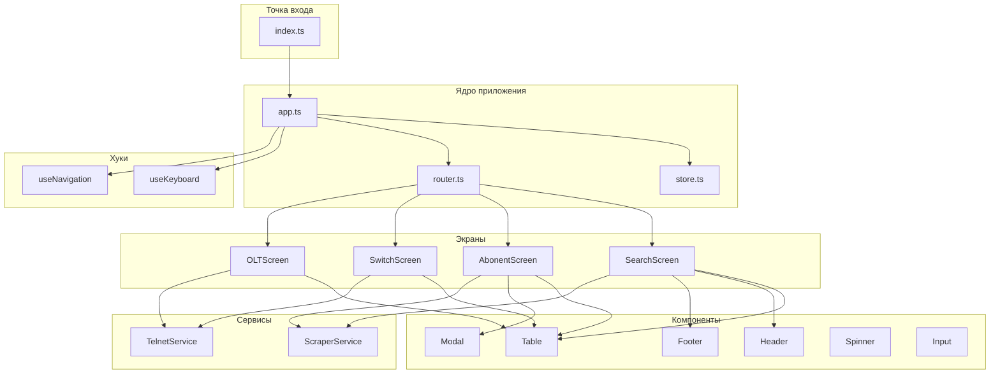
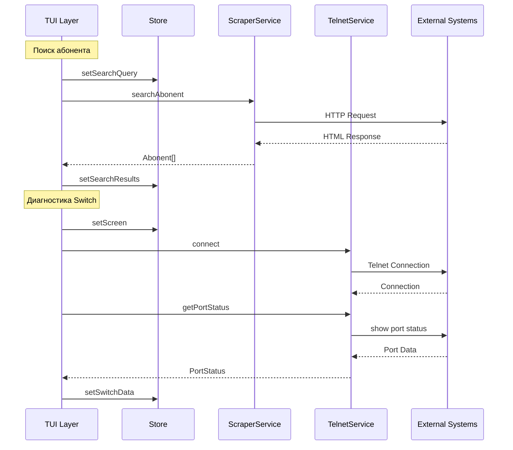

# Bungee TUI — Архитектура на OpenTUI

## 1. Обзор архитектуры

### 1.1 Ключевые принципы

1. **Чистый OpenTUI без React** — использование Constructs API (функциональный стиль)
2. **Модульная структура** — разделение на экраны, компоненты и хуки
3. **Централизованное состояние** — единый Store для управления данными между экранами
4. **Событийно-ориентированная навигация** — конечный автомат для переключения экранов

### 1.2 Диаграмма компонентов



---

## 2. Структура файлов

```
src/tui/
├── index.ts              # Экспорт и инициализация TUI
├── app.ts                # Корневой компонент приложения
├── store.ts              # Центральное хранилище состояния
├── router.ts             # Маршрутизатор экранов
│
├── screens/
│   ├── search.screen.ts  # Экран поиска абонента
│   ├── abonent.screen.ts # Карточка абонента
│   ├── switch.screen.ts  # Диагностика Switch
│   └── olt.screen.ts     # Диагностика OLT
│
├── components/
│   ├── table.component.ts    # Таблица с навигацией
│   ├── header.component.ts   # Заголовок приложения
│   ├── footer.component.ts   # Статус-бар с горячими клавишами
│   ├── modal.component.ts    # Модальное окно
│   ├── spinner.component.ts  # Индикатор загрузки
│   └── input.component.ts    # Поле ввода
│
└── hooks/
    ├── useKeyboard.ts    # Обработка клавиатуры
    └── useNavigation.ts  # Навигация по элементам
```

---

## 3. Описание модулей

### 3.1 Точка входа — [`index.ts`](src/tui/index.ts)

**Ответственность:**
- Инициализация CLI renderer
- Создание корневого компонента App
- Запуск приложения

```typescript
// src/tui/index.ts
import { createCliRenderer, Box, Text } from "@opentui/core";
import { createApp } from "./app.js";

const renderer = await createCliRenderer({ 
  exitOnCtrlC: true,
  title: "Bungee TUI"
});

// Инициализация приложения
const app = createApp(renderer);

// Монтирование в root
renderer.root.add(app);

// Экспорт для внешнего использования
export { renderer, app };
```

### 3.2 Корневой компонент — [`app.ts`](src/tui/app.ts)

**Ответственность:**
- Управление текущим экраном
- Подключение глобальных хуков
- Рендер Header + Content + Footer

```typescript
// src/tui/app.ts
import { Box, Text } from "@opentui/core";
import type { CliRenderer } from "@opentui/core";
import { createStore, type AppState } from "./store.js";
import { createRouter, type ScreenId } from "./router.js";
import { createHeader } from "./components/header.component.js";
import { createFooter } from "./components/footer.component.js";
import { useKeyboard } from "./hooks/useKeyboard.js";

export function createApp(renderer: CliRenderer) {
  const store = createStore();
  const router = createRouter(store);
  
  // Глобальные горячие клавиши
  useKeyboard(renderer, {
    onF1: () => store.showHelp(),
    onF3: () => router.navigate("search"),
    onF5: () => store.refresh(),
    onEscape: () => router.back(),
  });

  // Корневой контейнер
  return Box(
    { 
      flexDirection: "column", 
      width: "100%", 
      height: "100%" 
    },
    // Header
    createHeader(store),
    // Основной контент (динамический экран)
    Box(
      { flexGrow: 1, flexDirection: "column" },
      () => router.getCurrentScreen()
    ),
    // Footer
    createFooter(store)
  );
}
```

### 3.3 Хранилище состояния — [`store.ts`](src/tui/store.ts)

**Ответственность:**
- Хранение данных приложения
- Управление состоянием экранов
- Реактивные обновления через подписки

```typescript
// src/tui/store.ts
import type { Abonent, AbonentDetails, PortStatus, ONUInfo } from "../types/index.js";

export type ScreenId = "search" | "abonent" | "switch" | "olt" | "help";

export interface AppState {
  // Навигация
  currentScreen: ScreenId;
  screenHistory: ScreenId[];
  
  // Данные поиска
  searchQuery: string;
  searchResults: Abonent[];
  searchLoading: boolean;
  searchError: string | null;
  
  // Выбранный абонент
  selectedAbonent: AbonentDetails | null;
  abonentLoading: boolean;
  
  // Диагностика Switch
  switchData: PortStatus | null;
  switchLoading: boolean;
  
  // Диагностика OLT
  oltData: ONUInfo | null;
  oltLoading: boolean;
  
  // UI состояние
  isHelpVisible: boolean;
  focusedElement: string | null;
}

export type StoreSubscriber = (state: AppState) => void;

export function createStore() {
  let state: AppState = {
    currentScreen: "search",
    screenHistory: [],
    searchQuery: "",
    searchResults: [],
    searchLoading: false,
    searchError: null,
    selectedAbonent: null,
    abonentLoading: false,
    switchData: null,
    switchLoading: false,
    oltData: null,
    oltLoading: false,
    isHelpVisible: false,
    focusedElement: null,
  };
  
  const subscribers: Set<StoreSubscriber> = new Set();
  
  function notify() {
    subscribers.forEach(fn => fn(state));
  }
  
  return {
    getState: () => state,
    
    subscribe(fn: StoreSubscriber) {
      subscribers.add(fn);
      return () => subscribers.delete(fn);
    },
    
    // Навигация
    setScreen(screen: ScreenId) {
      state = {
        ...state,
        screenHistory: [...state.screenHistory, state.currentScreen],
        currentScreen: screen,
      };
      notify();
    },
    
    back() {
      const history = [...state.screenHistory];
      const previous = history.pop() || "search";
      state = {
        ...state,
        screenHistory: history,
        currentScreen: previous,
      };
      notify();
    },
    
    // Поиск
    setSearchQuery(query: string) {
      state = { ...state, searchQuery: query };
      notify();
    },
    
    setSearchResults(results: Abonent[]) {
      state = { 
        ...state, 
        searchResults: results,
        searchLoading: false,
        searchError: null,
      };
      notify();
    },
    
    setSearchLoading(loading: boolean) {
      state = { ...state, searchLoading: loading };
      notify();
    },
    
    setSearchError(error: string | null) {
      state = { 
        ...state, 
        searchError: error,
        searchLoading: false,
      };
      notify();
    },
    
    // Абонент
    setSelectedAbonent(abonent: AbonentDetails) {
      state = { 
        ...state, 
        selectedAbonent: abonent,
        abonentLoading: false,
      };
      notify();
    },
    
    // Диагностика
    setSwitchData(data: PortStatus) {
      state = { ...state, switchData: data, switchLoading: false };
      notify();
    },
    
    setOltData(data: ONUInfo) {
      state = { ...state, oltData: data, oltLoading: false };
      notify();
    },
    
    // UI
    showHelp() {
      state = { ...state, isHelpVisible: true };
      notify();
    },
    
    hideHelp() {
      state = { ...state, isHelpVisible: false };
      notify();
    },
    
    setFocusedElement(element: string | null) {
      state = { ...state, focusedElement: element };
      notify();
    },
    
    refresh() {
      // Триггер обновления текущего экрана
      notify();
    },
  };
}

export type Store = ReturnType<typeof createStore>;
```

### 3.4 Маршрутизатор — [`router.ts`](src/tui/router.ts)

**Ответственность:**
- Переключение между экранами
- Создание экземпляров экранов
- Управление историей навигации

```typescript
// src/tui/router.ts
import type { Store, ScreenId } from "./store.js";
import { createSearchScreen } from "./screens/search.screen.js";
import { createAbonentScreen } from "./screens/abonent.screen.js";
import { createSwitchScreen } from "./screens/switch.screen.js";
import { createOLTScreen } from "./screens/olt.screen.js";

export function createRouter(store: Store) {
  // Кэш созданных экранов
  const screens: Map<ScreenId, ReturnType<typeof createScreen>> = new Map();
  
  function createScreen(id: ScreenId) {
    switch (id) {
      case "search":
        return createSearchScreen(store);
      case "abonent":
        return createAbonentScreen(store);
      case "switch":
        return createSwitchScreen(store);
      case "olt":
        return createOLTScreen(store);
      default:
        throw new Error(`Unknown screen: ${id}`);
    }
  }
  
  return {
    navigate(screen: ScreenId) {
      store.setScreen(screen);
    },
    
    back() {
      store.back();
    },
    
    getCurrentScreen() {
      const state = store.getState();
      let screen = screens.get(state.currentScreen);
      
      if (!screen) {
        screen = createScreen(state.currentScreen);
        screens.set(state.currentScreen, screen);
      }
      
      return screen;
    },
  };
}

export type Router = ReturnType<typeof createRouter>;
```

---

## 4. Экраны

### 4.1 Экран поиска — [`search.screen.ts`](src/tui/screens/search.screen.ts)

**Ответственность:**
- Поле ввода для поиска
- Таблица результатов
- Обработка выбора абонента

```typescript
// src/tui/screens/search.screen.ts
import { Box, Text, Input, TextAttributes } from "@opentui/core";
import type { Store } from "../store.js";
import { createTable } from "../components/table.component.js";
import { ScraperService } from "../../services/scraper/index.js";

export function createSearchScreen(store: Store) {
  const scraper = new ScraperService();
  let selectedIndex = 0;
  let searchTimeout: Timer | null = null;
  
  // Колонки таблицы
  const columns = [
    { key: "account", title: "Лицевой счёт", width: 12 },
    { key: "fullName", title: "ФИО", width: 25 },
    { key: "address", title: "Адрес", width: 30 },
    { key: "status", title: "Статус", width: 10 },
  ];
  
  // Обработчик поиска с debounce
  async function handleSearch(query: string) {
    if (searchTimeout) clearTimeout(searchTimeout);
    
    store.setSearchQuery(query);
    
    if (query.length < 2) {
      store.setSearchResults([]);
      return;
    }
    
    searchTimeout = setTimeout(async () => {
      store.setSearchLoading(true);
      try {
        const results = await scraper.searchAbonent({
          type: "account", // Универсальный поиск
          value: query,
          limit: 50,
        });
        store.setSearchResults(results);
      } catch (error) {
        store.setSearchError(error.message);
      }
    }, 300);
  }
  
  // Обработчик выбора абонента
  function handleSelect(index: number) {
    const state = store.getState();
    const abonent = state.searchResults[index];
    if (abonent) {
      store.setScreen("abonent");
      // Загрузка деталей абонента
      loadAbonentDetails(abonent.id);
    }
  }
  
  async function loadAbonentDetails(id: string) {
    store.setAbonentLoading(true);
    try {
      const details = await scraper.getAbonentDetails(id);
      store.setSelectedAbonent(details);
    } catch (error) {
      store.setSearchError(error.message);
    }
  }
  
  return Box(
    { flexDirection: "column", flexGrow: 1, padding: 1 },
    // Заголовок
    Text({ 
      content: "Поиск абонента", 
      attributes: TextAttributes.BOLD 
    }),
    
    // Поле поиска
    Box(
      { marginTop: 1, marginBottom: 1 },
      Input({
        placeholder: "Введите лицевой счёт, ФИО или адрес...",
        value: store.getState().searchQuery,
        onChange: handleSearch,
        focus: true,
      })
    ),
    
    // Результаты поиска
    () => {
      const state = store.getState();
      
      if (state.searchLoading) {
        return Text({ content: "Поиск...", attributes: TextAttributes.DIM });
      }
      
      if (state.searchError) {
        return Text({ 
          content: `Ошибка: ${state.searchError}`, 
          fg: "red" 
        });
      }
      
      if (state.searchResults.length === 0) {
        return Text({ 
          content: "Введите критерий поиска", 
          attributes: TextAttributes.DIM 
        });
      }
      
      return createTable({
        columns,
        data: state.searchResults,
        selectedIndex,
        onSelect: handleSelect,
        onNavigate: (index) => { selectedIndex = index; },
      });
    }
  );
}
```

### 4.2 Карточка абонента — [`abonent.screen.ts`](src/tui/screens/abonent.screen.ts)

**Ответственность:**
- Отображение информации об абоненте
- Таблица оборудования
- Кнопки действий (Switch/OLT)

```typescript
// src/tui/screens/abonent.screen.ts
import { Box, Text, TextAttributes } from "@opentui/core";
import type { Store } from "../store.js";
import { createTable } from "../components/table.component.js";

export function createAbonentScreen(store: Store) {
  const state = store.getState();
  const abonent = state.selectedAbonent;
  
  if (!abonent) {
    return Box(
      { flexGrow: 1, alignItems: "center", justifyContent: "center" },
      Text({ content: "Загрузка...", attributes: TextAttributes.DIM })
    );
  }
  
  // Колонки таблицы оборудования
  const equipmentColumns = [
    { key: "type", title: "Тип", width: 8 },
    { key: "model", title: "Модель", width: 15 },
    { key: "mac", title: "MAC", width: 18 },
    { key: "ip", title: "IP", width: 15 },
    { key: "port", title: "Порт", width: 8 },
  ];
  
  return Box(
    { flexDirection: "column", flexGrow: 1, padding: 1 },
    // Заголовок с ФИО и статусом
    Box(
      { marginBottom: 1 },
      Text({ 
        content: `${abonent.fullName} `, 
        attributes: TextAttributes.BOLD 
      }),
      Text({ 
        content: getStatusLabel(abonent.status),
        fg: getStatusColor(abonent.status),
      }),
    ),
    
    // Адрес
    Text({ 
      content: abonent.address.full,
      attributes: TextAttributes.DIM,
    }),
    
    // Контактная информация
    Box({ marginTop: 1 },
      Text({ content: `Телефон: ${abonent.phone || "—"}` }),
      Text({ content: " | " }),
      Text({ content: `IP: ${abonent.ip || "—"}` }),
      Text({ content: " | " }),
      Text({ content: `Тариф: ${abonent.tariff}` }),
    ),
    
    // Баланс
    Box(
      { marginTop: 1, marginBottom: 1 },
      Text({ content: `Баланс: ${abonent.balance.toFixed(2)} ₽` }),
    ),
    
    // Таблица оборудования
    Text({ 
      content: "Оборудование:", 
      attributes: TextAttributes.BOLD,
    }),
    Box({ marginTop: 1 },
      createTable({
        columns: equipmentColumns,
        data: abonent.equipment,
        onSelect: (index) => {
          const equipment = abonent.equipment[index];
          if (equipment.type === "switch") {
            store.setScreen("switch");
          } else if (equipment.type === "onu") {
            store.setScreen("olt");
          }
        },
      })
    ),
  );
}

function getStatusLabel(status: string): string {
  const labels: Record<string, string> = {
    active: "Активен",
    blocked: "Заблокирован",
    suspended: "Приостановлен",
    disconnected: "Отключён",
  };
  return labels[status] || status;
}

function getStatusColor(status: string): string {
  const colors: Record<string, string> = {
    active: "green",
    blocked: "red",
    suspended: "yellow",
    disconnected: "gray",
  };
  return colors[status] || "white";
}
```

### 4.3 Диагностика Switch — [`switch.screen.ts`](src/tui/screens/switch.screen.ts)

**Ответственность:**
- Отображение статуса порта
- Статистика ошибок
- Графики трафика

```typescript
// src/tui/screens/switch.screen.ts
import { Box, Text, TextAttributes } from "@opentui/core";
import type { Store } from "../store.js";
import { DLinkClient } from "../../services/telnet/clients/dlink.client.js";

export function createSwitchScreen(store: Store) {
  const state = store.getState();
  const abonent = state.selectedAbonent;
  
  // Загрузка данных при первом рендере
  if (!state.switchData && !state.switchLoading) {
    loadSwitchData();
  }
  
  async function loadSwitchData() {
    const equipment = abonent?.equipment.find(e => e.type === "switch");
    if (!equipment) return;
    
    const client = new DLinkClient({
      host: equipment.ip!,
      port: 23,
      timeout: 10000,
    });
    
    try {
      await client.connect();
      const status = await client.getPortStatus(equipment.port!);
      store.setSwitchData(status);
      await client.disconnect();
    } catch (error) {
      store.setSearchError(`Ошибка подключения к Switch: ${error.message}`);
    }
  }
  
  if (state.switchLoading) {
    return Box(
      { flexGrow: 1, alignItems: "center", justifyContent: "center" },
      Text({ content: "Подключение к Switch...", attributes: TextAttributes.DIM })
    );
  }
  
  const data = state.switchData;
  if (!data) {
    return Box(
      { flexGrow: 1, alignItems: "center", justifyContent: "center" },
      Text({ content: "Нет данных", attributes: TextAttributes.DIM })
    );
  }
  
  return Box(
    { flexDirection: "column", flexGrow: 1, padding: 1 },
    // Заголовок
    Text({ 
      content: `Диагностика: D-Link (порт ${data.port})`,
      attributes: TextAttributes.BOLD,
    }),
    
    // Статус порта
    Box(
      { marginTop: 1, flexDirection: "row" },
      Text({ content: "Статус: " }),
      Text({ 
        content: data.status === "up" ? "● UP" : "○ DOWN",
        fg: data.status === "up" ? "green" : "red",
      }),
      Text({ content: ` | Скорость: ${data.speed} Mbps` }),
      Text({ content: ` | Дуплекс: ${data.duplex}` }),
    ),
    
    // Ошибки
    Box({ marginTop: 1 },
      Text({ content: "Ошибки: ", attributes: TextAttributes.BOLD }),
      Text({ content: `CRC: 0 | FCS: 0 | Collisions: 0` }),
    ),
    
    // Трафик (визуализация)
    Box({ marginTop: 1 },
      Text({ content: "Трафик:", attributes: TextAttributes.BOLD }),
    ),
    Box({ marginTop: 1 },
      createTrafficBar("Входящий", 1.2, 100),
    ),
    Box({ marginTop: 1 },
      createTrafficBar("Исходящий", 2.3, 100),
    ),
  );
}

function createTrafficBar(label: string, value: number, max: number) {
  const percentage = Math.min((value / max) * 100, 100);
  const filled = Math.round(percentage / 5);
  const empty = 20 - filled;
  
  return Box(
    { flexDirection: "row" },
    Text({ content: `${label}: ` }),
    Text({ content: "█".repeat(filled), fg: "green" }),
    Text({ content: "░".repeat(empty), fg: "gray" }),
    Text({ content: ` ${value.toFixed(1)} Mbps` }),
  );
}
```

### 4.4 Диагностика OLT — [`olt.screen.ts`](src/tui/screens/olt.screen.ts)

**Ответственность:**
- Информация об ONU
- Уровень сигнала (Rx/Tx)
- Визуализация затухания

```typescript
// src/tui/screens/olt.screen.ts
import { Box, Text, TextAttributes } from "@opentui/core";
import type { Store } from "../store.js";
import { OLTClient } from "../../services/telnet/clients/olt.client.js";

export function createOLTScreen(store: Store) {
  const state = store.getState();
  const abonent = state.selectedAbonent;
  
  // Загрузка данных при первом рендере
  if (!state.oltData && !state.oltLoading) {
    loadOLTData();
  }
  
  async function loadOLTData() {
    const equipment = abonent?.equipment.find(e => e.type === "onu");
    if (!equipment) return;
    
    const client = new OLTClient({
      host: equipment.ip || "10.0.1.1",
      port: 23,
      timeout: 10000,
    });
    
    try {
      await client.connect();
      const details = await client.getOnuDetails(equipment.mac);
      store.setOltData(details);
      await client.disconnect();
    } catch (error) {
      store.setSearchError(`Ошибка подключения к OLT: ${error.message}`);
    }
  }
  
  if (state.oltLoading) {
    return Box(
      { flexGrow: 1, alignItems: "center", justifyContent: "center" },
      Text({ content: "Подключение к OLT...", attributes: TextAttributes.DIM })
    );
  }
  
  const data = state.oltData;
  if (!data) {
    return Box(
      { flexGrow: 1, alignItems: "center", justifyContent: "center" },
      Text({ content: "Нет данных", attributes: TextAttributes.DIM })
    );
  }
  
  return Box(
    { flexDirection: "column", flexGrow: 1, padding: 1 },
    // Заголовок
    Text({ 
      content: `Диагностика: ONU ${data.mac}`,
      attributes: TextAttributes.BOLD,
    }),
    
    // Информация ONU
    Box({ marginTop: 1, flexDirection: "column" },
      Text({ content: `Vendor: ${data.vendor} | Model: ${data.model}` }),
      Text({ content: `Firmware: ${data.firmware} | Uptime: ${formatUptime(data.uptime)}` }),
      Text({ 
        content: `Статус: ${data.status}`,
        fg: data.status === "registered" ? "green" : "yellow",
      }),
    ),
    
    // Уровень сигнала
    Box({ marginTop: 1 },
      Text({ content: "Уровень сигнала:", attributes: TextAttributes.BOLD }),
    ),
    Box({ marginTop: 1 },
      createSignalBar("Rx Power", data.signal.rxPower, -8, -28, "dBm"),
    ),
    Box({ marginTop: 1 },
      createSignalBar("Tx Power", data.signal.txPower, 0, 6, "dBm"),
    ),
    Box({ marginTop: 1 },
      createSignalBar("Attenuation", data.signal.attenuation, 0, 20, "dB"),
    ),
  );
}

function createSignalBar(
  label: string, 
  value: number, 
  max: number, 
  min: number, 
  unit: string
) {
  const range = max - min;
  const percentage = Math.min(((value - min) / range) * 100, 100);
  const filled = Math.round(percentage / 5);
  const empty = 20 - filled;
  
  const isNormal = value >= min && value <= max;
  
  return Box(
    { flexDirection: "row" },
    Text({ content: `${label}: ${value.toFixed(1)} ${unit} ` }),
    Text({ 
      content: "█".repeat(filled), 
      fg: isNormal ? "green" : "yellow" 
    }),
    Text({ content: "░".repeat(empty), fg: "gray" }),
    Text({ 
      content: isNormal ? " НОРМА" : " ВНИМАНИЕ",
      fg: isNormal ? "green" : "yellow",
    }),
  );
}

function formatUptime(seconds: number): string {
  const days = Math.floor(seconds / 86400);
  const hours = Math.floor((seconds % 86400) / 3600);
  return `${days} дн. ${hours} ч.`;
}
```

---

## 5. Компоненты

### 5.1 Таблица — [`table.component.ts`](src/tui/components/table.component.ts)

**Ответственность:**
- Отображение данных в виде таблицы
- Навигация стрелками
- Подсветка выбранной строки

```typescript
// src/tui/components/table.component.ts
import { Box, Text, TextAttributes } from "@opentui/core";

export interface TableColumn<T> {
  key: keyof T;
  title: string;
  width: number;
  align?: "left" | "center" | "right";
}

export interface TableProps<T> {
  columns: TableColumn<T>[];
  data: T[];
  selectedIndex: number;
  onSelect: (index: number) => void;
  onNavigate: (index: number) => void;
}

export function createTable<T extends Record<string, any>>(
  props: TableProps<T>
) {
  const { columns, data, selectedIndex, onSelect, onNavigate } = props;
  
  return Box(
    { flexDirection: "column", width: "100%" },
    // Заголовок таблицы
    Box(
      { 
        flexDirection: "row", 
        borderBottom: true,
        paddingBottom: 1,
        marginBottom: 1,
      },
      ...columns.map(col =>
        Text({ 
          content: col.title.padEnd(col.width),
          attributes: TextAttributes.BOLD,
        })
      )
    ),
    
    // Строки данных
    ...data.map((row, index) =>
      Box(
        {
          flexDirection: "row",
          backgroundColor: index === selectedIndex ? "blue" : undefined,
          paddingLeft: index === selectedIndex ? 1 : 0,
        },
        ...columns.map(col => {
          const value = String(row[col.key] ?? "");
          return Text({
            content: value.padEnd(col.width),
            attributes: index === selectedIndex 
              ? TextAttributes.BOLD 
              : undefined,
          });
        })
      )
    )
  );
}
```

### 5.2 Header — [`header.component.ts`](src/tui/components/header.component.ts)

**Ответственность:**
- Название приложения
- Версия
- Текущий экран

```typescript
// src/tui/components/header.component.ts
import { Box, Text, TextAttributes } from "@opentui/core";
import type { Store } from "../store.js";

export function createHeader(store: Store) {
  const state = store.getState();
  const screenTitles: Record<string, string> = {
    search: "Поиск абонента",
    abonent: "Карточка абонента",
    switch: "Диагностика Switch",
    olt: "Диагностика OLT",
  };
  
  return Box(
    { 
      flexDirection: "row", 
      justifyContent: "space-between",
      padding: 1,
      borderBottom: true,
    },
    // Название
    Box(
      { flexDirection: "row" },
      Text({ 
        content: "Bungee", 
        attributes: TextAttributes.BOLD,
        fg: "cyan",
      }),
      Text({ 
        content: " v1.0.0",
        attributes: TextAttributes.DIM,
      }),
    ),
    
    // Текущий экран
    Text({ 
      content: screenTitles[state.currentScreen] || state.currentScreen,
    }),
  );
}
```

### 5.3 Footer — [`footer.component.ts`](src/tui/components/footer.component.ts)

**Ответственность:**
- Горячие клавиши для текущего экрана
- Контекстная подсказка

```typescript
// src/tui/components/footer.component.ts
import { Box, Text, TextAttributes } from "@opentui/core";
import type { Store } from "../store.js";

export function createFooter(store: Store) {
  const state = store.getState();
  
  // Горячие клавиши по умолчанию
  const defaultKeys = [
    { key: "F1", label: "Справка" },
    { key: "F3", label: "Поиск" },
    { key: "F5", label: "Обновить" },
    { key: "Esc", label: "Назад" },
  ];
  
  // Контекстные клавиши для экранов
  const contextKeys: Record<string, Array<{key: string; label: string}>> = {
    abonent: [
      { key: "D", label: "Диагностика" },
      { key: "S", label: "Switch" },
      { key: "O", label: "OLT" },
    ],
    switch: [
      { key: "Enter", label: "Детали" },
      { key: "C", label: "Очистить" },
    ],
    olt: [
      { key: "Enter", label: "История" },
      { key: "R", label: "Перезагрузить" },
    ],
  };
  
  const keys = [
    ...(contextKeys[state.currentScreen] || []),
    ...defaultKeys,
  ];
  
  return Box(
    { 
      flexDirection: "row", 
      justifyContent: "center",
      padding: 1,
      borderTop: true,
    },
    ...keys.map((item, index) =>
      Box(
        { flexDirection: "row" },
        Text({ 
          content: `[${item.key}]`,
          attributes: TextAttributes.BOLD,
          fg: "cyan",
        }),
        Text({ content: ` ${item.label}` }),
        index < keys.length - 1 ? Text({ content: "  " }) : null,
      )
    )
  );
}
```

### 5.4 Modal — [`modal.component.ts`](src/tui/components/modal.component.ts)

**Ответственность:**
- Модальные окна (справка, ошибки)
- Блокировка основного контента

```typescript
// src/tui/components/modal.component.ts
import { Box, Text, TextAttributes } from "@opentui/core";

export interface ModalProps {
  title: string;
  content: string | string[];
  onClose: () => void;
}

export function createModal(props: ModalProps) {
  const { title, content, onClose } = props;
  const lines = Array.isArray(content) ? content : [content];
  
  return Box(
    {
      position: "absolute",
      top: "50%",
      left: "50%",
      transform: "translate(-50%, -50%)",
      width: 60,
      border: true,
      borderColor: "white",
      backgroundColor: "black",
    },
    // Заголовок
    Box(
      {
        flexDirection: "row",
        justifyContent: "space-between",
        borderBottom: true,
        paddingBottom: 1,
      },
      Text({ content: title, attributes: TextAttributes.BOLD }),
      Text({ content: "[X]", attributes: TextAttributes.DIM }),
    ),
    
    // Контент
    Box(
      { flexDirection: "column", padding: 1 },
      ...lines.map(line => Text({ content: line }))
    ),
    
    // Кнопка закрытия
    Box(
      { 
        flexDirection: "row", 
        justifyContent: "center",
        borderTop: true,
        paddingTop: 1,
      },
      Text({ 
        content: "[ Enter ] Закрыть",
        attributes: TextAttributes.BOLD,
      }),
    )
  );
}
```

### 5.5 Spinner — [`spinner.component.ts`](src/tui/components/spinner.component.ts)

**Ответственность:**
- Индикатор загрузки
- Анимация кадров

```typescript
// src/tui/components/spinner.component.ts
import { Text, TextAttributes } from "@opentui/core";

const frames = ["⠋", "⠙", "⠹", "⠸", "⠼", "⠴", "⠦", "⠧", "⠇", "⠏"];

export function createSpinner(label: string = "Загрузка") {
  let frameIndex = 0;
  
  return {
    render() {
      const frame = frames[frameIndex];
      frameIndex = (frameIndex + 1) % frames.length;
      
      return Text(
        { fg: "cyan" },
        Text({ content: `${frame} ${label}...` }),
      );
    },
    
    tick() {
      frameIndex = (frameIndex + 1) % frames.length;
    },
  };
}
```

---

## 6. Хуки

### 6.1 Обработка клавиатуры — [`useKeyboard.ts`](src/tui/hooks/useKeyboard.ts)

**Ответственность:**
- Глобальные горячие клавиши
- Маппинг клавиш на действия

```typescript
// src/tui/hooks/useKeyboard.ts
import type { CliRenderer } from "@opentui/core";

export interface KeyboardHandlers {
  onF1?: () => void;
  onF3?: () => void;
  onF5?: () => void;
  onF10?: () => void;
  onEscape?: () => void;
  onEnter?: () => void;
  onArrowUp?: () => void;
  onArrowDown?: () => void;
  onArrowLeft?: () => void;
  onArrowRight?: () => void;
  onTab?: () => void;
  onShiftTab?: () => void;
  onKey?: (key: string) => void;
}

export function useKeyboard(
  renderer: CliRenderer, 
  handlers: KeyboardHandlers
) {
  const keyMap: Record<string, () => void> = {
    // Функциональные клавиши
    "f1": handlers.onF1 || (() => {}),
    "f3": handlers.onF3 || (() => {}),
    "f5": handlers.onF5 || (() => {}),
    "f10": handlers.onF10 || (() => {}),
    
    // Специальные клавиши
    "escape": handlers.onEscape || (() => {}),
    "return": handlers.onEnter || (() => {}),
    "up": handlers.onArrowUp || (() => {}),
    "down": handlers.onArrowDown || (() => {}),
    "left": handlers.onArrowLeft || (() => {}),
    "right": handlers.onArrowRight || (() => {}),
    "tab": handlers.onTab || (() => {}),
    "shift+tab": handlers.onShiftTab || (() => {}),
  };
  
  renderer.keyInput.on("keypress", (event: { name: string; shift: boolean }) => {
    const key = event.shift ? `shift+${event.name}` : event.name;
    const handler = keyMap[key];
    
    if (handler) {
      handler();
    } else if (handlers.onKey) {
      handlers.onKey(key);
    }
  });
  
  return {
    dispose: () => {
      renderer.keyInput.removeAllListeners("keypress");
    },
  };
}
```

### 6.2 Навигация — [`useNavigation.ts`](src/tui/hooks/useNavigation.ts)

**Ответственность:**
- Навигация по списку
- Поддержка Page Up/Down
- Поддержка Home/End

```typescript
// src/tui/hooks/useNavigation.ts
import { useState } from "@opentui/core";

export interface NavigationOptions {
  itemCount: number;
  pageSize?: number;
  onSelect?: (index: number) => void;
  onChange?: (index: number) => void;
}

export function useNavigation(options: NavigationOptions) {
  const { itemCount, pageSize = 10, onSelect, onChange } = options;
  
  let selectedIndex = 0;
  let offset = 0;
  
  function clampIndex(index: number): number {
    return Math.max(0, Math.min(index, itemCount - 1));
  }
  
  function setIndex(index: number) {
    const newIndex = clampIndex(index);
    if (newIndex !== selectedIndex) {
      selectedIndex = newIndex;
      onChange?.(newIndex);
    }
  }
  
  return {
    get selectedIndex() { return selectedIndex; },
    get offset() { return offset; },
    
    up() {
      setIndex(selectedIndex - 1);
    },
    
    down() {
      setIndex(selectedIndex + 1);
    },
    
    pageUp() {
      setIndex(selectedIndex - pageSize);
    },
    
    pageDown() {
      setIndex(selectedIndex + pageSize);
    },
    
    home() {
      setIndex(0);
    },
    
    end() {
      setIndex(itemCount - 1);
    },
    
    select() {
      onSelect?.(selectedIndex);
    },
    
    handleKey(key: string) {
      switch (key) {
        case "up": this.up(); break;
        case "down": this.down(); break;
        case "pageup": this.pageUp(); break;
        case "pagedown": this.pageDown(); break;
        case "home": this.home(); break;
        case "end": this.end(); break;
        case "return": this.select(); break;
      }
    },
  };
}
```

---

## 7. Интеграция с сервисами

### 7.1 Диаграмма потока данных



### 7.2 Паттерн интеграции

```typescript
// Пример интеграции сервиса в экран
import { ScraperService } from "../../services/scraper/index.js";

export function createSearchScreen(store: Store) {
  // Создание экземпляра сервиса
  const scraper = new ScraperService();
  
  // Обработчик с обработкой ошибок
  async function handleSearch(query: string) {
    store.setSearchLoading(true);
    try {
      const results = await scraper.searchAbonent({ 
        type: "account", 
        value: query 
      });
      store.setSearchResults(results);
    } catch (error) {
      store.setSearchError(error.message);
    }
  }
  
  // Очистка при размонтировании
  function cleanup() {
    scraper.close();
  }
  
  return { render: /* ... */, cleanup };
}
```

---

## 8. План реализации

### Этап 1: Базовая инфраструктура
- [ ] Создать структуру директорий `src/tui/`
- [ ] Реализовать `store.ts` — центральное хранилище
- [ ] Реализовать `router.ts` — маршрутизатор
- [ ] Реализовать `app.ts` — корневой компонент
- [ ] Реализовать `index.ts` — точка входа

### Этап 2: Базовые компоненты
- [ ] Реализовать `header.component.ts`
- [ ] Реализовать `footer.component.ts`
- [ ] Реализовать `table.component.ts`
- [ ] Реализовать `modal.component.ts`
- [ ] Реализовать `spinner.component.ts`

### Этап 3: Хуки
- [ ] Реализовать `useKeyboard.ts`
- [ ] Реализовать `useNavigation.ts`

### Этап 4: Экраны
- [ ] Реализовать `search.screen.ts`
- [ ] Реализовать `abonent.screen.ts`
- [ ] Реализовать `switch.screen.ts`
- [ ] Реализовать `olt.screen.ts`

### Этап 5: Интеграция с сервисами
- [ ] Подключить `ScraperService` к экрану поиска
- [ ] Подключить `TelnetService` к экранам диагностики
- [ ] Реализовать обработку ошибок

### Этап 6: Тестирование и отладка
- [ ] Протестировать навигацию между экранами
- [ ] Протестировать горячие клавиши
- [ ] Протестировать интеграцию с сервисами
- [ ] Оптимизировать производительность

---

## 9. Ключевые архитектурные решения

### 9.1 Управление состоянием

**Решение:** Центральный Store с подпиской на изменения.

**Обоснование:**
- Простота отладки — все изменения в одном месте
- Предсказуемость — однонаправленный поток данных
- Реактивность — автоматическое обновление UI

### 9.2 Навигация

**Решение:** Конечный автомат с историей переходов.

**Обоснование:**
- Поддержка кнопки "Назад" (Esc)
- Возможность восстановления состояния экрана
- Простота добавления новых экранов

### 9.3 Переиспользуемые компоненты

**Решение:** Функции-фабрики с пропсами.

**Обоснование:**
- Соответствует Constructs API OpenTUI
- Простота тестирования
- Явная передача зависимостей

### 9.4 Интеграция с сервисами

**Решение:** Прямое использование сервисов в экранах.

**Обоснование:**
- Минимальная связность
- Возможность мокирования для тестов
- Асинхронная загрузка данных

---

*Документ создан: 2026-04-12*
*Версия: 1.0.0*
