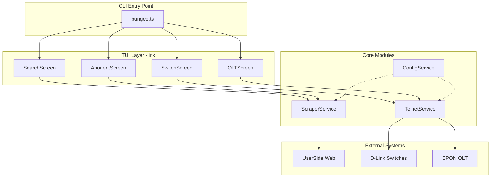
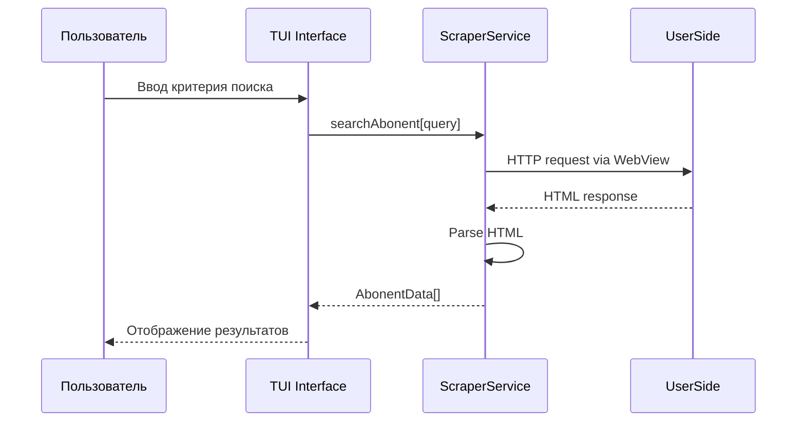
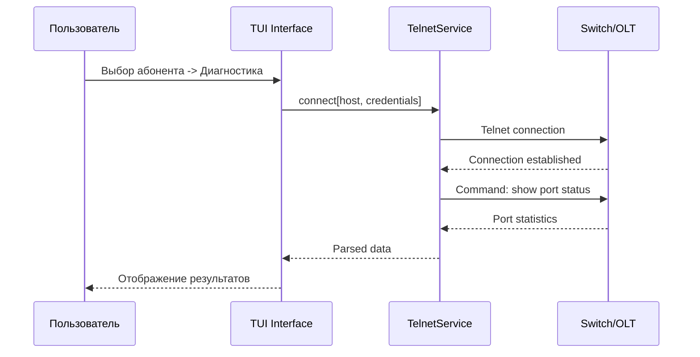

# Bungee CLI — Спецификация

## 1. Общее описание

**Bungee** — это терминальная TUI-утилита для технической поддержки провайдера, написанная на Bun. Утилита предоставляет единый интерфейс для:

- Поиска абонентов по различным критериям
- Получения информации о состоянии сетевого оборудования
- Диагностики подключений абонентов

### Ключевые возможности

| Возможность | Описание |
|-------------|----------|
| Поиск абонента | По номеру лицевого счёта, адресу, ФИО, IP-адресу |
| Диагностика ETTH | Статус порта D-Link, скорость, ошибки, трафик |
| Диагностика GPON | MAC ONU, статус ONU, затухание сигнала |
| TUI-интерфейс | Интерактивный терминальный интерфейс в стиле htop |

---

## 2. Архитектура системы



### Поток данных при поиске абонента



### Поток данных при диагностике оборудования



---

## 3. Структура проекта

```
bungee/
├── src/
│   ├── index.ts                 # Точка входа CLI
│   │
│   ├── config/
│   │   ├── index.ts             # Экспорт конфигурации
│   │   ├── schema.ts            # Схема валидации .env
│   │   └── loader.ts            # Загрузчик конфигурации
│   │
│   ├── services/
│   │   ├── scraper/
│   │   │   ├── index.ts         # Экспорт ScraperService
│   │   │   ├── scraper.service.ts
│   │   │   ├── parsers/
│   │   │   │   ├── abonent.parser.ts
│   │   │   │   └── address.parser.ts
│   │   │   └── types.ts
│   │   │
│   │   └── telnet/
│   │       ├── index.ts         # Экспорт TelnetService
│   │       ├── telnet.service.ts
│   │       ├── clients/
│   │       │   ├── dlink.client.ts
│   │       │   └── olt.client.ts
│   │       └── types.ts
│   │
│   ├── tui/
│   │   ├── index.ts             # Экспорт TUI компонентов
│   │   ├── app.tsx              # Корневой компонент ink
│   │   ├── screens/
│   │   │   ├── search.screen.tsx
│   │   │   ├── abonent.screen.tsx
│   │   │   ├── switch.screen.tsx
│   │   │   └── olt.screen.tsx
│   │   ├── components/
│   │   │   ├── header.component.tsx
│   │   │   ├── footer.component.tsx
│   │   │   ├── table.component.tsx
│   │   │   ├── input.component.tsx
│   │   │   ├── spinner.component.tsx
│   │   │   └── modal.component.tsx
│   │   └── hooks/
│   │       ├── useKeyboard.hook.ts
│   │       └── useNavigation.hook.ts
│   │
│   └── types/
│       ├── abonent.types.ts
│       ├── switch.types.ts
│       ├── olt.types.ts
│       └── common.types.ts
│
├── .env                         # Конфигурация
├── .env.example                 # Пример конфигурации
├── package.json
├── tsconfig.json
├── bunfig.toml
└── README.md
```

---

## 4. Конфигурация

### Переменные окружения [.env]

```env
# === UserSide Configuration ===
USERSIDE_URL=http://userside.piramida.local
USERSIDE_USER=operator
USERSIDE_PASS=secure_password

# === Telnet Configuration ===
TELNET_TIMEOUT=10000
TELNET_RETRIES=3

# === D-Link Switches ===
DLINK_DEFAULT_USER=admin
DLINK_DEFAULT_PASS=dlink_pass

# === EPON OLT ===
OLT_DEFAULT_USER=root
OLT_DEFAULT_PASS=olt_pass

# === Application Settings ===
LOG_LEVEL=info
CACHE_TTL=300
```

### Схема конфигурации

```typescript
interface Config {
  userside: {
    url: string;
    user: string;
    pass: string;
  };
  telnet: {
    timeout: number;    // ms
    retries: number;
  };
  etth: {
    defaultUser: string;
    defaultPass: string;
  };
  gpon: {
    defaultUser: string;
    defaultPass: string;
  };
  app: {
    logLevel: 'debug' | 'info' | 'warn' | 'error';
    cacheTtl: number;   // seconds
  };
}
```

---

## 5. Команды CLI

### Базовые команды

```bash
# Запуск интерактивного TUI
bungee
```
---

## 6. Модули

### 6.1 WebView Scraper Service

Модуль для взаимодействия с веб-интерфейсом UserSide через Bun.WebView.

**Основные методы:**

```typescript
class ScraperService {
  // Авторизация в UserSide
  async login(): Promise<void>;
  
  // Поиск абонента по критерию
  async searchAbonent(query: SearchQuery): Promise<Abonent[]>;
  
  // Получение детальной информации об абоненте
  async getAbonentDetails(id: string): Promise<AbonentDetails>;
  
  // Получение списка оборудования абонента
  async getAbonentEquipment(id: string): Promise<Equipment[]>;
  
  // Закрытие сессии
  async close(): Promise<void>;
}
```

**Парсеры:**

| Парсер | Назначение |
|--------|------------|
| `AbonentParser` | Извлечение данных абонента из HTML |
| `AddressParser` | Нормализация адресных данных |
| `EquipmentParser` | Парсинг информации об оборудовании |

### 6.2 Telnet Service

Модуль для подключения к сетевому оборудованию по протоколу Telnet.

**Базовый класс:**

```typescript
class TelnetService {
  constructor(config: TelnetConfig);
  
  // Установка соединения
  async connect(): Promise<void>;
  
  // Отправка команды
  async sendCommand(command: string): Promise<string>;
  
  // Закрытие соединения
  async disconnect(): Promise<void>;
  
  // Проверка доступности
  async ping(): Promise<boolean>;
}
```

### 6.3 D-Link Client

Специализированный клиент для коммутаторов D-Link.

```typescript
class DLinkClient extends TelnetService {
  // Статус порта
  async getPortStatus(port: number): Promise<PortStatus>;
  
  // Статистика ошибок порта
  async getPortErrors(port: number): Promise<PortErrors>;
  
  // Статистика трафика
  async getPortTraffic(port: number): Promise<PortTraffic>;
  
  // Скорость порта
  async getPortSpeed(port: number): Promise<PortSpeed>;
  
  // Информация о MAC-адресах
  async getMacTable(port: number): Promise<MacEntry[]>;
}
```

### 6.4 EPON OLT Client

Клиент для GPON/EPON OLT.

```typescript
class OLTClient extends TelnetService {
  // Список ONU на порту
  async getOnuList(port: number): Promise<ONUInfo[]>;
  
  // Детальная информация об ONU
  async getOnuDetails(onuId: string): Promise<ONUDetails>;
  
  // Статус ONU
  async getOnuStatus(onuId: string): Promise<ONUStatus>;
  
  // Затухание сигнала
  async getOnuSignal(onuId: string): Promise<ONUSignal>;
}
```

---

## 7. Типы данных

### 7.1 Основные типы

```typescript
// === Абонент ===

interface Abonent {
  id: string;
  account: string;           // Лицевой счёт
  fullName: string;          // ФИО
  address: Address;
  phone?: string;
  ip?: string;
  tariff: string;
  status: AbonentStatus;
  balance: number;
}

interface Address {
  city: string;
  street: string;
  house: string;
  apartment?: string;
  full: string;              // Полный адрес строкой
}

type AbonentStatus = 
  | 'active'
  | 'blocked'
  | 'suspended'
  | 'disconnected';

interface AbonentDetails extends Abonent {
  equipment: Equipment[];
  connections: Connection[];
  services: Service[];
}

// === Оборудование ===

interface Equipment {
  type: EquipmentType;
  model: string;
  mac: string;
  ip?: string;
  port?: number;
  location?: string;
}

type EquipmentType = 
  | 'switch'
  | 'olt'
  | 'onu'
  | 'router';

// === Коммутатор D-Link ===

interface PortStatus {
  port: number;
  status: 'up' | 'down';
  speed: number;             // Mbps
  duplex: 'full' | 'half';
  flowControl: boolean;
}

interface PortErrors {
  port: number;
  crcErrors: number;
  collisions: number;
  fcsErrors: number;
  overflow: number;
  total: number;
}

interface PortTraffic {
  port: number;
  inOctets: number;
  outOctets: number;
  inUcastPkts: number;
  outUcastPkts: number;
  inErrors: number;
  outErrors: number;
}

interface MacEntry {
  mac: string;
  vlan: number;
  port: number;
  type: 'dynamic' | 'static';
}

// === EPON OLT ===

interface ONUInfo {
  onuId: string;
  mac: string;
  port: number;
  status: ONUStatus;
}

type ONUStatus = 
  | 'registered'
  | 'llid-admin-down'
  | 'wire-down'
  | 'offline'
  | 'power-off'
  | 'unknown';

interface ONUDetails extends ONUInfo {
  vendor: string;
  model: string;
  firmware: string;
  uptime: number;            // seconds
  signal: ONUSignal;
}

interface ONUSignal {
  rxPower: number;           // dBm
  txPower: number;           // dBm
  distance: number;          // meters
  attenuation: number;       // dB
}

// === Поиск ===

interface SearchQuery {
  type: 'account' | 'address' | 'name' | 'ip';
  value: string;
  limit?: number;
}

// === Результаты диагностики ===

interface DiagnosticResult {
  success: boolean;
  timestamp: Date;
  data?: AbonentDetails | PortStatus | ONUInfo;
  errors?: string[];
}
```

---

## 8. TUI Интерфейс

### 8.1 Главное окно - Поиск

```
┌─ Bungee v1.0.0 ─────────────────────────────────────────────────────────────┐
│ Поиск абонента                                                              │
├─────────────────────────────────────────────────────────────────────────────┤
│                                                                             │
│ ┌─ Критерий поиска ─────────────────────────────────────────────────────┐  │
│ │ > Иванов                                                            ▼ │  │
│ └───────────────────────────────────────────────────────────────────────┘  │
│                                                                             │
│ ┌─ Результаты (3) ──────────────────────────────────────────────────────┐  │
│ │ #    Лицевой счёт    ФИО                    Адрес               Статус │  │
│ ├──────┼────────────────┼──────────────────────┼─────────────────┼───────┤  │
│ │ 1    123456          Иванов Иван Иванович    ул. Ленина, 15    ████    │  │
│ │ 2    234567          Иванов Петр Сергеевич   ул. Мира, 8       ████    │  │
│ │ 3    345678          Иванова Анна            ул. Гагарина, 3   ████    │  │
│ └───────────────────────────────────────────────────────────────────────┘  │
│                                                                             │
├─────────────────────────────────────────────────────────────────────────────┤
│ [Enter] Выбрать  [Tab] Фильтр  [Esc] Выход  [F1] Помощь  [F5] Обновить     │
└─────────────────────────────────────────────────────────────────────────────┘
```

### 8.2 Карточка абонента

```
┌─ Абонент: 123456 ───────────────────────────────────────────────────────────┐
│ Иванов Иван Иванович                                              Активен  │
│ ул. Ленина, д. 15, кв. 42                                                   │
│ Телефон: +7 (XXX) XXX-XX-XX  |  IP: 192.168.1.100  |  Тариф: "Премиум 100" │
├─────────────────────────────────────────────────────────────────────────────┤
│                                                                             │
│ ┌─ Оборудование ─────────────────────────────────────────────────────────┐ │
│ │ Тип        Модель          MAC                IP              Порт     │ │
│ │ Switch     D-Link DGS-1210  AA:BB:CC:DD:EE:FF  10.0.0.5        12      │ │
│ │ ONU        Huawei HG8245H   11:22:33:44:55:66  -               3/1     │ │
│ └───────────────────────────────────────────────────────────────────────┘ │
│                                                                             │
│ ┌─ Баланс ──────────────────────────────────────────────────────────────┐ │
│ │ Текущий баланс: 1,234.56 ₽   |   Последний платёж: 15.01.2026         │ │
│ └───────────────────────────────────────────────────────────────────────┘ │
│                                                                             │
├─────────────────────────────────────────────────────────────────────────────┤
│ [D] Диагностика  [S] Switch  [O] OLT  [R] Обновить  [Esc] Назад  [Q] Выход │
└─────────────────────────────────────────────────────────────────────────────┘
```

### 8.3 Диагностика Switch

```
┌─ Диагностика: D-Link DGS-1210 (10.0.0.5) ───────────────────────────────────┐
│ Порт: 12  |  MAC абонента: AA:BB:CC:DD:EE:FF                                │
├─────────────────────────────────────────────────────────────────────────────┤
│                                                                             │
│ ┌─ Статус порта ─────────────────────────────────────────────────────────┐ │
│ │ Статус:  ● UP          Скорость:  100 Mbps     Дуплекс:  Full          │ │
│ │ Flow Control: Enabled  Link:      Stable                      │ │
│ └───────────────────────────────────────────────────────────────────────┘ │
│                                                                             │
│ ┌─ Ошибки (за последний час) ────────────────────────────────────────────┐ │
│ │ CRC Errors:  0         FCS Errors:  0          Collisions:  0          │ │
│ │ Overflow:    0         Total:      0           ▓▓▓▓▓▓▓▓▓▓             │ │
│ └───────────────────────────────────────────────────────────────────────┘ │
│                                                                             │
│ ┌─ Трафик ───────────────────────────────────────────────────────────────┐ │
│ │                Входящий              Исходящий                         │ │
│ │ Байты:         1,234,567             2,345,678                         │ │
│ │ Пакеты:        12,345                23,456                            │ │
│ │ Скорость:      1.2 Mbps              2.3 Mbps                         │ │
│ │                                                                      │ │
│ │ ████████████████████░░░░  Вход    ████████████████████████░░░░  Выход │ │
│ └───────────────────────────────────────────────────────────────────────┘ │
│                                                                             │
├─────────────────────────────────────────────────────────────────────────────┤
│ [Enter] Детали  [F5] Обновить  [C] Очистить счетчики  [Esc] Назад           │
└─────────────────────────────────────────────────────────────────────────────┘
```

### 8.4 Диагностика OLT / ONU

```
┌─ Диагностика: EPON OLT (10.0.1.1) ──────────────────────────────────────────┐
│ Порт: 3/1  |  ONU ID: 1                                                     │
├─────────────────────────────────────────────────────────────────────────────┤
│                                                                             │
│ ┌─ Информация ONU ────────────────────────────────────────────────────────┐ │
│ │ MAC:          11:22:33:44:55:66     Vendor:     Huawei                  │ │
│ │ Model:        HG8245H              Firmware:   V300R018                 │ │
│ │ Uptime:       15 дней 3 часа                                            │ │
│ │ Статус ONU: ● REGISTERED                                                │ │
│ └─────────────────────────────────────────────────────────────────────────┘ │
│                                                                             │
│ ┌─ Уровень сигнала ──────────────────────────────────────────────────────┐ │
│ │                                                                             │ │
│ │  Rx Power:    -18.5 dBm     ████████████████░░░░  НОРМА                 │ │
│ │  Tx Power:    +2.3 dBm      ████████████████████  НОРМА                 │ │
│ │  Distance:    1,234 м                                                          │ │
│ │  Attenuation: 12.5 dB       ██████████████░░░░░░  НОРМА                 │ │
│ │                                                                             │ │
│ │  Диапазон Rx: -8 ... -28 dBm                                                │ │
│ │                                                                             │ │
│ └───────────────────────────────────────────────────────────────────────┘ │
│                                                                             │
├─────────────────────────────────────────────────────────────────────────────┤
│ [Enter] История  [R] Перезагрузить ONU  [F5] Обновить  [Esc] Назад          │
└─────────────────────────────────────────────────────────────────────────────┘
```

### 8.5 Модальное окно справки

```
┌─────────────────────────────────────────────────────────────────────────────┐
│                              СПРАВКА                                   [X] │
├─────────────────────────────────────────────────────────────────────────────┤
│                                                                             │
│  НАВИГАЦИЯ                                                                  │
│  ─────────────────────────────────────────────────────────────────────────  │
│  ↑/↓/←/→    Перемещение по списку                                          │
│  Enter       Выбрать / Подтвердить                                          │
│  Tab         Переключение между полями                                      │
│  Esc         Назад / Выход                                                  │
│                                                                             │
│  ПОИСК                                                                      │
│  ─────────────────────────────────────────────────────────────────────────  │
│  F3         Быстрый поиск                                                   │
│  Ctrl+F      Расширенный поиск                                              │
│                                                                             │
│  ДЕЙСТВИЯ                                                                   │
│  ─────────────────────────────────────────────────────────────────────────  │
│  D          Диагностика абонента                                            │
│  S          Подключение к Switch                                            │
│  O          Подключение к OLT                                               │
│  R          Обновить данные                                                 │
│  F5         Обновить текущий экран                                          │
│                                                                             │
│  ОКНО                                                                       │
│  ─────────────────────────────────────────────────────────────────────────  │
│  F1         Справка                                                         │
│  F10        Выход                                                           │
│  Q          Быстрый выход                                                   │
│                                                                             │
├─────────────────────────────────────────────────────────────────────────────┤
│                                    [ Enter ] Закрыть                        │
└─────────────────────────────────────────────────────────────────────────────┘
```

---

## 9. Примеры использования

### Сценарий 1: Поиск абонента по адресу

1. Запуск утилиты: `bungee`
2. Ввод адреса в поле поиска: `ул. Ленина 15` (или ФИО, или ввод лицевого счёта - универсальный поиск с единым эндпоинтом)
3. Выбор абонента из списка (стрелками + Enter)
4. Просмотр информации об абоненте
5. Нажатие `D` для диагностики

---

## 10. Горячие клавиши

### Общие клавиши

| Клавиша | Действие |
|---------|----------|
| `F1` | Справка |
| `F3` | Быстрый поиск |
| `F5` | Обновить данные |
| `F10` / `Q` | Выход |
| `Esc` | Назад / Отмена |
| `Tab` | Следующее поле |
| `Shift+Tab` | Предыдущее поле |

### Навигация

| Клавиша | Действие |
|---------|----------|
| `↑` / `↓` | Навигация по списку |
| `←` / `→` | Горизонтальная навигация |
| `Home` / `End` | Начало / конец списка |
| `PgUp` / `PgDn` | Страница вверх / вниз |
| `Enter` | Выбрать / Подтвердить |

### Действия с абонентом

| Клавиша | Действие |
|---------|----------|
| `D` | Диагностика подключения |
| `S` | Открыть Switch (если ETTH) |
| `O` | Открыть OLT (если EPON) |
| `R` | Обновить данные |
| `C` | Копировать данные |
| `/` | Начать поиск |

### Диагностика оборудования

| Клавиша | Действие |
|---------|----------|
| `Enter` | Детальная информация |
| `C` | Очистить счетчики ошибок |
| `R` | Перезагрузить ONU (только для OLT) |
| `L` | Лог команд |
| `E` | Экспорт данных |

---

## 11. Обработка ошибок

### Типы ошибок

```typescript
enum ErrorCode {
  CONNECTION_FAILED = 'CONNECTION_FAILED',
  AUTH_FAILED = 'AUTH_FAILED',
  TIMEOUT = 'TIMEOUT',
  NOT_FOUND = 'NOT_FOUND',
  PERMISSION_DENIED = 'PERMISSION_DENIED',
  PARSE_ERROR = 'PARSE_ERROR',
  UNKNOWN = 'UNKNOWN'
}

interface AppError {
  code: ErrorCode;
  message: string;
  details?: string;
  timestamp: Date;
}
```

### Отображение ошибок в TUI

```
┌─────────────────────────────────────────────────────────────────────────────┐
│ ⚠ ОШИБКА                                                                   │
├─────────────────────────────────────────────────────────────────────────────┤
│                                                                             │
│   Не удалось подключиться к коммутатору                                     │
│                                                                             │
│   Хост:      10.0.0.5                                                       │
│   Порт:      23                                                             │
│   Причина:   Connection timed out (10000ms)                                 │
│                                                                             │
│   Рекомендации:                                                             │
│   • Проверьте доступность хоста (ping)                                      │
│   • Убедитесь, что Telnet включён на устройстве                            │
│   • Проверьте настройки firewall                                            │
│                                                                             │
├─────────────────────────────────────────────────────────────────────────────┤
│                          [ R ] Повторить    [ Esc ] Закрыть                 │
└─────────────────────────────────────────────────────────────────────────────┘
```

---

## 12. Зависимости

Строго - никакого react.

### Runtime зависимости
- clipboardy (буфер обмена)

### Dev зависимости

```json
{
  "devDependencies": {
    "typescript": "^5.0.0",
    "bun-types": "latest"
  }
}
```

---

## 13. Дорожная карта

### Этап 1: Базовая инфраструктура
- [ ] Структура проекта
- [ ] Конфигурация и валидация

### Этап 2: Scraper Service
- [ ] Авторизация в UserSide
- [ ] Парсинг данных абонента
- [ ] Поиск по критериям

### Этап 3: Telnet Service
- [ ] Базовый Telnet клиент
- [ ] Switch клиент
- [ ] OLT клиент

### Этап 4: TUI Interface
- [ ] Каркас приложения
- [ ] Экран поиска
- [ ] Карточка абонента
- [ ] Диагностика оборудования

### Этап 5: Интеграция
- [ ] Связка компонентов
- [ ] Обработка ошибок
- [ ] Оптимизация производительности

---

*Документация создана: 2026-04-11*  
*Версия: 1.0.0*
